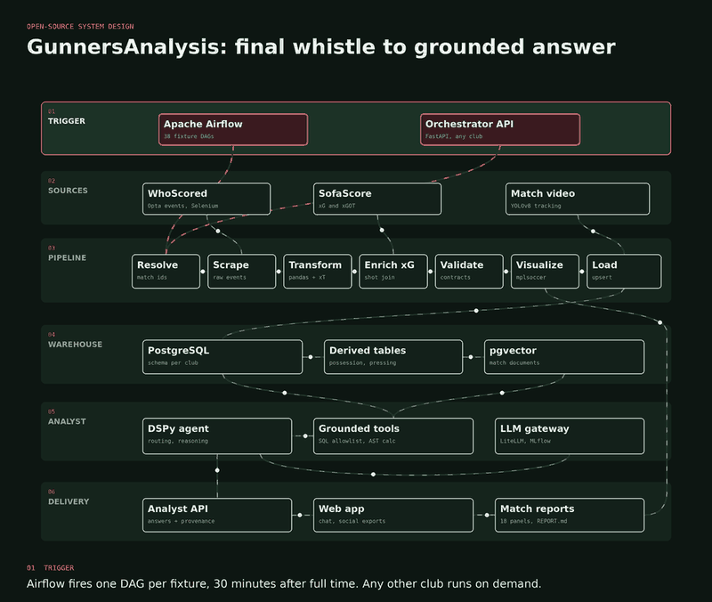
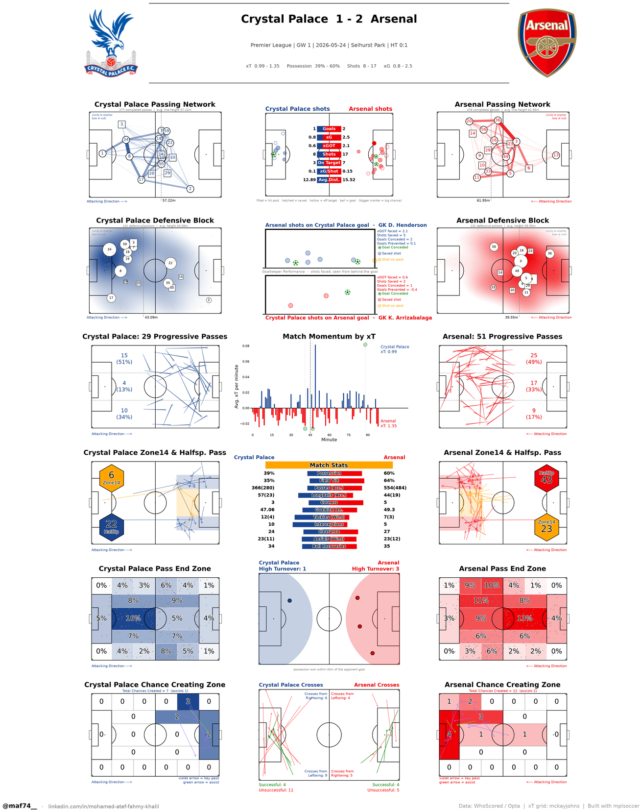
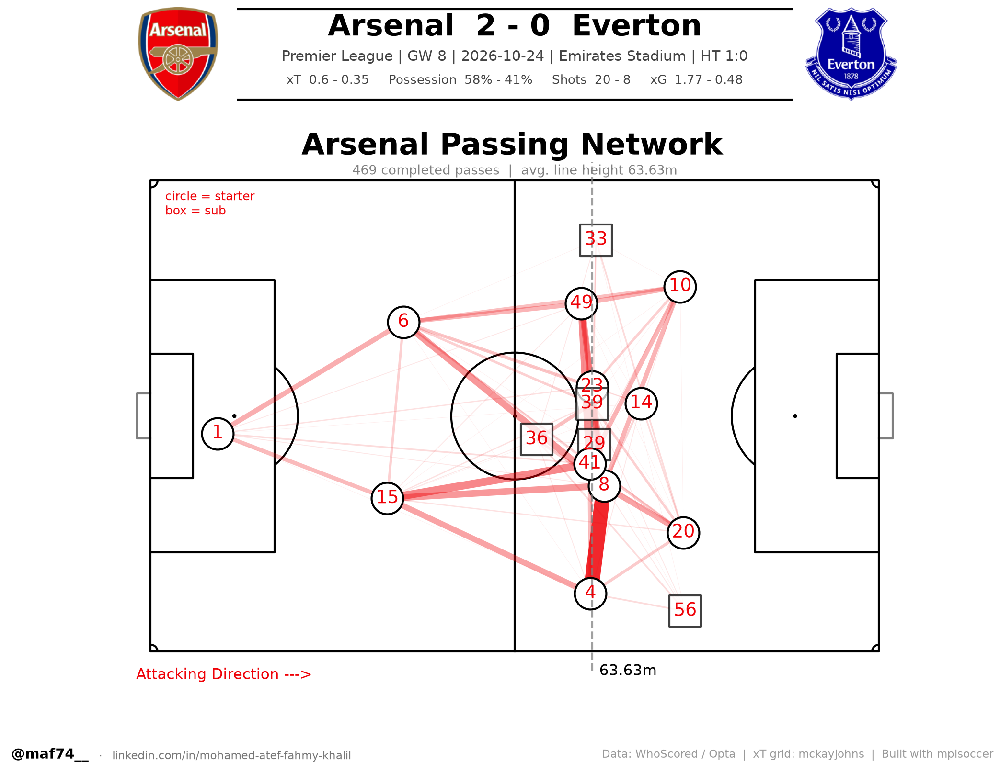
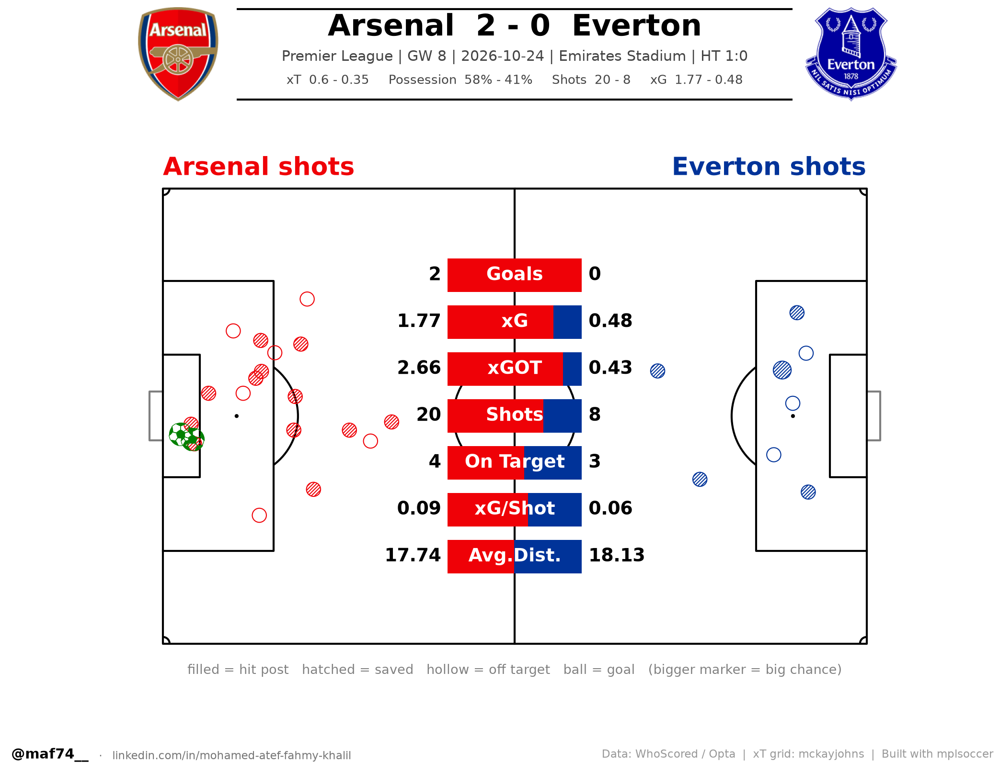
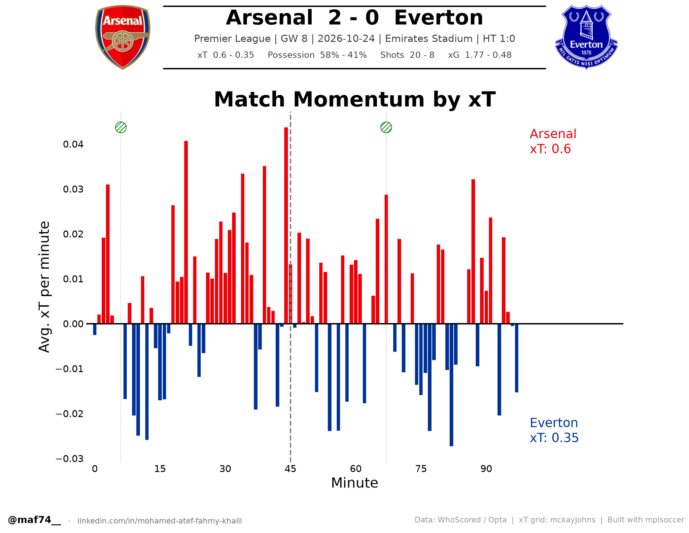
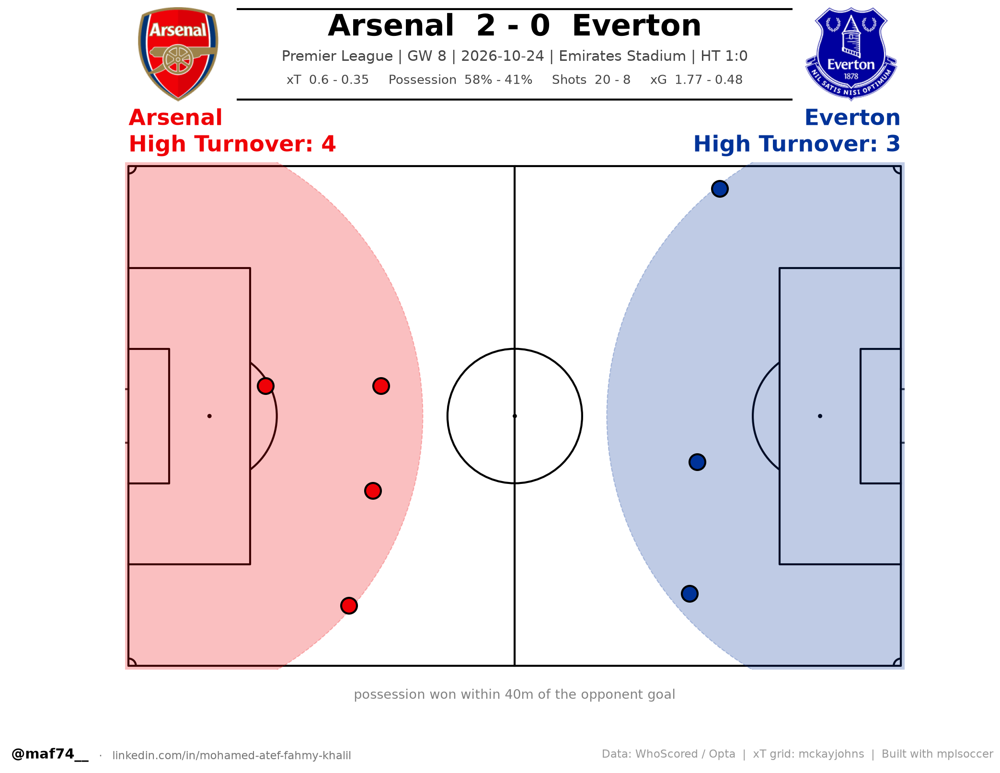

<div align="center">

# GunnersAnalysis

**From the final whistle to a grounded answer, with nobody pressing a button.**

Football data engineering, web scraping and AI in one open-source system.

    



</div>

Thirty minutes after an Arsenal match ends, an Airflow DAG wakes up. It scrapes the
full Opta event stream, enriches every shot with expected goals, validates the data
against typed contracts, renders an 18-panel tactical dashboard and loads every event
into PostgreSQL. On top of the warehouse sits an AI analyst that answers questions in
plain English and is built so it cannot invent a statistic.

Arsenal runs on autopilot for the whole season. Any other club, such as Barcelona, AC Milan
or Al Ahly, can be analysed on demand from two links.

---

## What you get after every match



<table>
<tr>
<td></td>
<td></td>
</tr>
<tr>
<td align="center">Pass network</td><td align="center">Shot map with xG and xGOT</td>
</tr>
<tr>
<td></td>
<td></td>
</tr>
<tr>
<td align="center">Match momentum by expected threat</td><td align="center">High turnovers within 40m of goal</td>
</tr>
</table>

Every match also gets a `match.json`, a written `REPORT.md` grounded in the panels, and
a row for every event, shot and player in the warehouse.

## How it works

| Layer | What happens | Built with |
|---|---|---|
| **1. Trigger** | One DAG per fixture fires 30 minutes after full time. A FastAPI service runs any match on demand. | Apache Airflow, FastAPI |
| **2. Sources** | WhoScored provides the Opta event stream, and SofaScore provides xG and xGOT. Neither is complete alone, so the pipeline joins them. | Selenium, requests |
| **3. Pipeline** | resolve, scrape, transform, enrich xG, validate, visualize, load | pandas, xT model, data contracts, mplsoccer |
| **4. Warehouse** | One schema per club, season views, derived possession, pressing and carry tables, and a semantic document corpus | PostgreSQL, pgvector |
| **5. Analyst** | An agent that picks allowlisted queries, delegates arithmetic to a sandboxed calculator, and checks every number against evidence | DSPy, LiteLLM, OpenRouter, MLflow |
| **6. Delivery** | Dashboards, written reports, a streaming analyst API and a web app | FastAPI, React |

There is also an experimental player-tracking module for match video, built on YOLOv8. See
[docs/TRACKING.md](docs/TRACKING.md).

A full write-up of every design decision is in [docs/ARCHITECTURE.md](docs/ARCHITECTURE.md).
New to football data? Start with [The Football Data Cookbook](docs/FOOTBALL_DATA_COOKBOOK.md).

## An AI analyst that cannot make up numbers

- **It never writes SQL.** The model picks a query id from an allowlist
  (`agent/tools/sql_registry.py`), and psycopg2 binds the parameters.
- **It never does arithmetic.** A calculator walks the expression's AST and allows only
  numbers, operators and whitelisted functions.
- **Every number is verified.** Each number in a drafted answer must match the evidence
  the tools returned. Anything that doesn't match is flagged and counted as a hallucination.
- **It refuses instead of guessing.** The eval set includes questions that can only be
  answered by refusing, and correct refusals are scored.

```bash
make ask Q="Was Arsenal a high-pressing side in 2025/26?"
```

Details: [docs/AGENT.md](docs/AGENT.md).

## Quick start

```bash
git clone https://github.com/Muhammadatef/gunners-analysis.git
cd gunners-analysis
cp .env.example .env          # set passwords and, for the analyst, OPENROUTER_API_KEY
docker compose up -d          # postgres, airflow, orchestrator, analyst, mlflow, redis

# seed the season calendar (idempotent)
docker compose exec airflow python /opt/gunners/db/seed_fixtures.py
```

- Airflow UI: <http://localhost:8080>
- Orchestrator API: <http://localhost:8000/docs>
- MLflow: <http://localhost:5000>

The default passwords in `docker-compose.yml` are for local development only. Set real
values in `.env` before exposing anything to a network.

### Render a match by hand

```bash
make render                 # newest scraped match, into output/<season>/<match>/
make load JOB=<job_id>      # then into the warehouse
```

### Any club, from two links

```bash
make match CLUB=barcelona \
  WS='https://www.whoscored.com/matches/.../live/...' \
  SS='https://www.sofascore.com/football/match/.../xyz' \
  COMP='Champions League' MW=6
```

Club crests are not shipped. Fetch them with `python visualizer/fetch_logos.py`.

## Season automation

`airflow/dags/arsenal_season_dag.py` generates **one DAG per fixture** from
`airflow/fixtures/arsenal_2026_27.json`. Each is scheduled by a cron pinned to
30 minutes after its own final whistle (kick-off + `MATCH_DURATION_MINUTES`,
default 115), bracketed by `start_date`/`end_date` so it can only fire once.

`arsenal_season_maintenance` runs Mondays 06:00 UK and re-seeds the calendar,
resolves WhoScored match ids for the next 21 days, and backfills anything that
missed its slot.

Full detail, including what to do when a fixture moves for TV:
[docs/AUTOMATION.md](docs/AUTOMATION.md).

## Asking it questions

On top of the warehouse sits an analyst that answers with cited evidence and is
architecturally unable to invent a statistic — it picks from an allowlist of
parameterised queries rather than writing SQL, never does arithmetic itself,
and every number in an answer is checked against the evidence before it is
returned.

```bash
make agent-setup                    # derived tables, documents, eval set
make ask Q="Was Arsenal a high-pressing side in 2025/26?"
make eval SPLIT=dev                 # measure it; the free tier costs nothing
```

[docs/AGENT.md](docs/AGENT.md) explains why the guarantee holds and what it
does not cover.

## A season that has already been played

The DAGs cover a season as it happens. To load one that is already finished —
all 38 matches, unattended:

```bash
make calendar BACKFILL_SEASON='2025/2026'   # derive it from SofaScore
make backfill                               # ingest it, match by match
```

The calendar is derived rather than typed, and carries each match's SofaScore
event id (so xG never has to be searched for) and its real final score (so a
transposed fixture is caught rather than loaded). The ingest resumes from the
warehouse itself, so re-running it retries only what failed.
[docs/BACKFILL.md](docs/BACKFILL.md) has the detail.

## Season warehouse

Postgres, defined in [`db/schema.sql`](db/schema.sql). **One club, one schema:**
Arsenal is `gunners`; every other club gets a complete clone of the same tables
and views (`make schema-club CLUB=barcelona`), so nothing is ever mixed.

| Grain | Tables |
|---|---|
| Season calendar | `fixtures` |
| Match | `matches`, `match_team_stats`, `quality_reports`, `visualizations` |
| Player-match | `match_player_stats`, `player_team_spells` |
| Event | `events`, `shots`, `pass_links` |
| Reference | `seasons`, `teams`, `players` |
| Audit | `pipeline_runs` |

Ready-made views: `v_team_season_summary` (league table), `v_player_season_totals`
(totals + per-90s), `v_team_match_results`, `v_season_progress`.

```sql
SELECT player_name, minutes, goals, assists, prog_passes_per_90, xt_per_90
FROM gunners.v_player_season_totals
WHERE team_name = 'Arsenal' ORDER BY xt_per_90 DESC;
```

Only Arsenal has a seeded fixture calendar, so `fixtures` and
`v_season_progress` are empty in other clubs' schemas; everything else is fully
populated. Schema notes and query recipes: [docs/DATABASE.md](docs/DATABASE.md).

## Repository layout

```
airflow/dags/          per-fixture + maintenance DAGs
airflow/fixtures/      2026/27 calendar (JSON) and its generator
db/                    schema.sql, loader, aggregates, connection, seeding
orchestrator/          FastAPI service, run_match.py CLI, pipeline stages
scraper/               Selenium scraper (real browser), SofaScore client,
                       WhoScored match-id resolver
transformer/           raw JSON -> EventData/PlayerData/metadata
quality/               importable data quality checks
visualizer/            match_report.py (the 18 panels) + club crests
contracts/             pydantic models for the interchange files
tests/unit/            schedule, quality, transformer, output layout, schema
                       routing, xG enrichment, browser mode, run_match
docs/                  architecture, automation, database, multi-club, visuals
output/                rendered reports, one directory per match
```

## Testing

```bash
make test        # 217 unit tests; prefers ./venv/bin/python, falls back to python3
```

## Known limitations

- **xG and xGOT are not in the WhoScored feed.** The `enrich_xg` stage fills the
  gap from SofaScore — by URL on the manual path, by walking Arsenal's calendar
  in the DAGs — and sums per-shot xG/xGOT. Best effort: if the match cannot be
  matched, or the competition has no xG, the run continues with `0.0` and
  `matches.xg_source` records why. Only the shot map and GK panels are affected.
- **Only Arsenal has a fixture calendar.** Other clubs load fine but with a
  `NULL fixture_id`, so `v_season_progress` stays empty for them, and the
  curated club-colour map covers the Premier League only — pass
  `--home-color`/`--away-color` for anyone else.
- **Kick-off times.** 34 of the 38 fixtures had no confirmed TV slot when the
  calendar was built, so they default to 15:00 UK. Re-run
  `airflow/fixtures/build_fixtures.py` then `db/seed_fixtures.py` once slots are announced.
- **WhoScored match ids** only exist a few weeks before kick-off, hence the
  resolve step; a fixture whose id is not published yet skips rather than fails.
- **Scraping is bot-sensitive.** The scraper runs a real browser rather than
  headless Chrome (`headed` on a desktop, Xvfb in a container) and keeps a
  persistent profile, but a challenge page is still possible; the DAG retries 6
  times at 30-minute intervals and the weekly maintenance DAG backfills anything
  still missing.
- **Some matches have no event stream at all.** WhoScored publishes plenty of
  friendlies and lower-tier matches with only a summary feed. The 18 panels are
  all derived from events, so those fall back to SofaScore's reduced nine-panel
  report.
- Some files under `data/` are owned by `root` from earlier container runs and
  need `chown` before a non-root process can overwrite them.

## Data and responsible use

This repository ships **code only**. It contains no scraped match data and no club
crests. WhoScored, SofaScore and FotMob own their data, and their terms of use apply
to anything you fetch with these tools. Use the project for personal, non-commercial
analysis, keep request rates low, and do not redistribute scraped data. Club names
and crests are trademarks of their owners. This is an independent fan project and is
not affiliated with Arsenal FC or any data provider.

## Contributing

Contributions are welcome: new panels, data sources, better xG matching, the tracking
module, and evaluation questions for the agent. See [CONTRIBUTING.md](CONTRIBUTING.md).

## License

[MIT](LICENSE)
