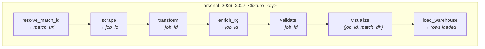
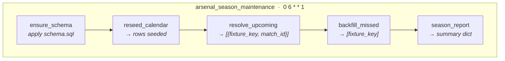
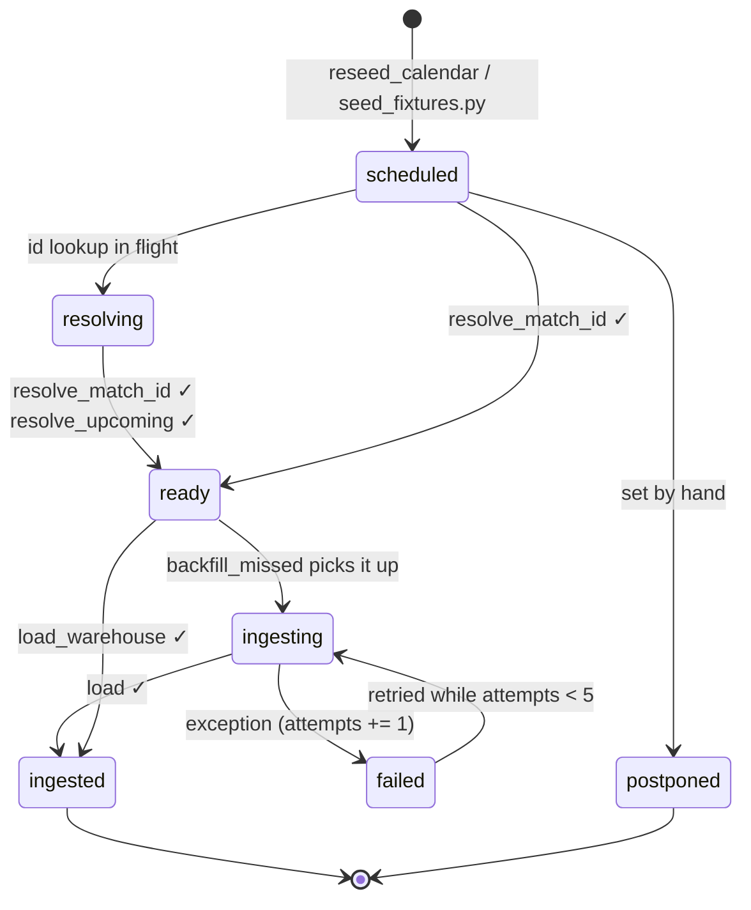

# Airflow DAG shapes

Two DAG families run the season. Both are defined with the TaskFlow API in
[`dags/`](dags/), and both import the pipeline stages from the project package
rather than shelling out — `GUNNERS_ROOT` (default `/opt/gunners`) is prepended
to `sys.path` at parse time.

| DAG | Source | Count | Schedule |
|---|---|---|---|
| `arsenal_2026_2027_<fixture_key>` | [`arsenal_season_dag.py`](dags/arsenal_season_dag.py) | 38 (one per fixture) | one-shot cron at kick-off + 4h |
| `arsenal_season_maintenance` | [`arsenal_season_maintenance_dag.py`](dags/arsenal_season_maintenance_dag.py) | 1 | `0 6 * * 1` (Mondays 06:00 UK) |

---

## 1. Per-fixture pipeline DAG

38 DAGs are generated at parse time by looping over
[`fixtures/arsenal_2026_27.json`](fixtures/arsenal_2026_27.json) and injecting
each resulting DAG object into `globals()`. Every one has the same seven-task
linear shape; only the `dag_id`, cron, date bracket and the captured `fixture`
dict differ.



Values on the arrows are the XCom payloads — the chain is wired by ordinary
function calls (`load_warehouse(visualize(validate(enrich_xg(transform(job)))))`),
so the dependency graph is strictly serial with no branching or fan-out.

### What each task does

| Task | Calls | Reads / writes | Failure behaviour |
|---|---|---|---|
| `resolve_match_id` | `scraper.fixtures.resolve_match_id`, `match_url` | reads Airflow Variable `match_id_<key>` as an override; sets `fixtures.whoscored_match_id`, `match_url`, `status='ready'` | raises `AirflowSkipException` when WhoScored has not published an id yet — **skip, not fail** |
| `scrape` | `WhoscoredScraper.scrape_match` (headless Selenium), `pipeline.extract_match_json` | writes `data/raw/match_<job_id>.html` + `.json` | retries (bot walls, slow match centre) |
| `transform` | `pipeline.run_transform` | raw JSON → `EventData` / `PlayerData` / metadata, applies the xT grid | retries |
| `enrich_xg` | `pipeline.enrich_xg` | pulls xG/xGOT from SofaScore, records `metadata.xg_source` | **best effort** — a failure leaves the placeholder values rather than killing the run |
| `validate` | `pipeline.run_quality` | writes the quality report | raises `ValueError` when the gate fails — hard stop |
| `visualize` | `visualizer.match_report.render_match` | renders the 18 panels into `output/<season>/mw<NN>_<date>_<home>_v_<away>/` | retries |
| `load_warehouse` | `db.loader.load` | loads events/shots/player+team stats into Postgres, sets `fixtures.status='ingested'` | retries |

### Scheduling model

Each DAG is pinned to its own match by a single-fire cron plus a date bracket:

```
kickoff_uk (or 15:00 default)
        │
        ├── + MATCH_DURATION_MINUTES (115)      ──►  final whistle
        │
        ├── + POST_MATCH_DELAY_MINUTES (30)     ──►  run_at   (kick-off + 2h25)
        │
   schedule    = "<min> <hour> <day> <month> *"     ← the day and month are literal
   start_date  = run_at − 1 day
   end_date    = run_at + 3 days
   catchup     = False,  max_active_runs = 1
```

Because the cron carries a literal day and month and `end_date` is only three
days later, the DAG can fire for exactly one match and then goes dormant.

The run lands 30 minutes after the expected final whistle. The whistle is
*derived*, not observed — kick-off plus 90 minutes, a 15-minute interval and
~10 of stoppage. That is deliberately tight against WhoScored's own processing
lag, and the retry policy is what absorbs it: 6 retries at 30-minute intervals,
a three-day `end_date`, and the maintenance DAG backfilling anything that still
missed. Extra time is not modelled — a cup tie that runs to 120 minutes simply
fires early and retries.

```mermaid
gantt
    title One fixture's timeline
    dateFormat HH:mm
    axisFormat %H:%M
    section Match
    kick-off               :milestone, ko, 00:00, 0m
    90 minutes + stoppage  :active, 00:00, 1h55m
    final whistle          :milestone, fw, 01:55, 0m
    section Airflow
    dormant (start_date reached)   :done, 00:00, 2h25m
    DAG fires                      :milestone, fire, 02:25, 0m
    retry window (6 × 30 min)      :crit, 02:25, 3h
```



`retries=6` at `retry_delay=30min` means a fixture has roughly three hours of
retry runway before the DAG gives up — after which the weekly maintenance DAG
becomes the safety net.

### Tags

Every DAG is tagged `arsenal`, the season, `mw<NN>`, `home`/`away` and the
opponent name, so the Airflow UI can be filtered down to a matchweek or an
opponent.

---

## 2. Maintenance DAG

One DAG, five tasks, also strictly linear — the chain is written with explicit
`>>` operators.



| Task | What it does |
|---|---|
| `ensure_schema` | applies `db/schema.sql` (idempotent) |
| `reseed_calendar` | re-seeds `fixtures` from the JSON calendar, so TV reschedules land |
| `resolve_upcoming` | one shared headless scraper resolves WhoScored ids for every fixture kicking off within `LOOKAHEAD_DAYS = 21` that still has `whoscored_match_id IS NULL` |
| `backfill_missed` | re-runs the **whole pipeline inline** for fixtures past kick-off (−6h cutoff) that are not `ingested`/`postponed`, have a `match_url`, and have `attempts < 5`; per-fixture try/except so one bad match cannot sink the run |
| `season_report` | prints fixture counts by status and Arsenal's line from `v_team_season_summary` to the task log |

Note that `backfill_missed` calls `extract_match_json → run_transform →
run_quality → run_visualize → run_load` sequentially inside a single task — it
is a compressed copy of the per-fixture DAG, not a trigger of it.

---

## 3. How the two DAGs meet

They never talk to each other directly. The `fixtures` table is the shared
state, and `fixtures.status` is the handshake:



- The per-fixture DAG drives `scheduled → ready → ingested` on the happy path.
- `backfill_missed` only touches fixtures that are **not** `ingested`, so a
  successful DAG run makes the maintenance DAG a no-op for that match.
- `attempts < 5` caps the backfill so a permanently broken fixture stops being
  retried every Monday; `last_error` keeps the reason.

---

## 4. Operational notes

- **Unconfirmed kick-offs.** 34 of 38 fixtures had no TV slot when the calendar
  was built and default to 15:00 UK. Re-run `fixtures/build_fixtures.py` then
  `db/seed_fixtures.py`; the DAGs pick up the new cron on the next parse.
- **Manual match id.** Set the Airflow Variable `match_id_<fixture_key>` to
  force a specific WhoScored id and bypass the slug lookup.
- **Parse cost.** All 38 DAGs are built on every scheduler parse. The loop only
  reads one JSON file and does no network I/O, so this is cheap — but any import
  added at module scope in the DAG file is paid 38 times.
- **Tuning the delay.** `POST_MATCH_DELAY_MINUTES` (default `30`) and
  `MATCH_DURATION_MINUTES` (default `115`) shift every generated cron. Raise the
  first if first attempts fail often enough to be noise. The superseded
  `PIPELINE_DELAY_HOURS` is still honoured if set, and overrides both — it sets
  the total offset from kick-off, as it always did.
