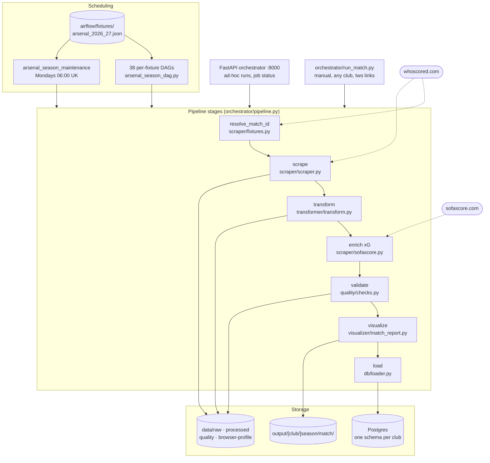
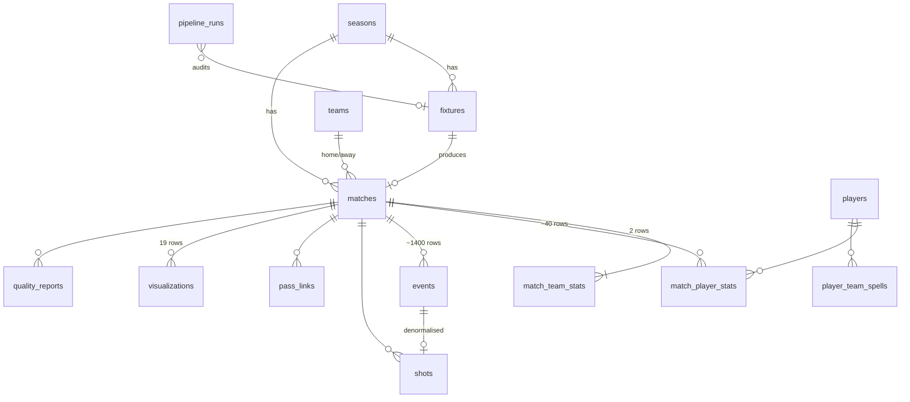
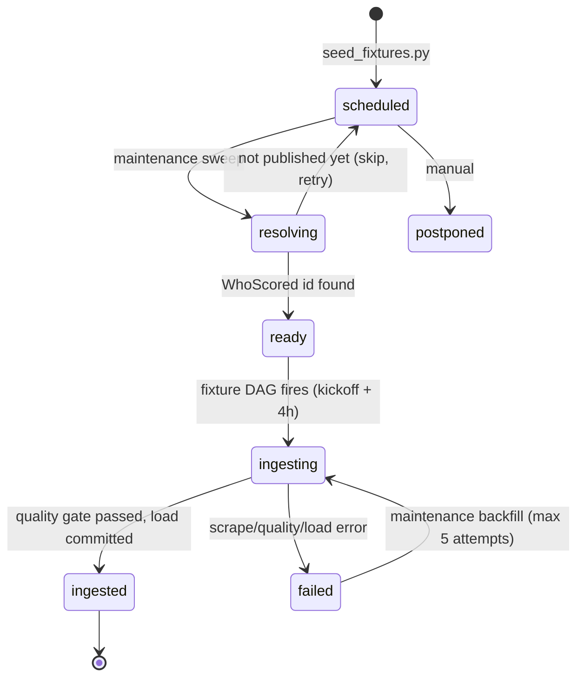

# Architecture

How GunnersAnalysis is put together: the services, the data flow through them,
the warehouse model, and the decisions worth knowing about before changing
anything.

---

## 1. System overview

Six components. Airflow drives the season; the FastAPI orchestrator exists for
ad-hoc single-match runs; everything else is a library that both can call.



### Why two entry points

Airflow owns the schedule; the pipeline stages own the work. `orchestrator/pipeline.py`
exposes each stage as a plain function so a DAG task, an API request, and a
`python -c` one-liner all execute the identical code path. The FastAPI service
originally shelled out to each service's CLI with `subprocess`, which swallowed
tracebacks and made retries expensive — the importable module replaced that.

---

## 2. Repository layout

```
airflow/
  dags/arsenal_season_dag.py              factory: one DAG per fixture
  dags/arsenal_season_maintenance_dag.py  reseed, resolve, backfill, report
  fixtures/build_fixtures.py              generates the calendar JSON
  fixtures/arsenal_2026_27.json           38 fixtures, the scheduling source of truth
  Dockerfile, requirements.txt            Airflow + chromium + analytics stack

db/
  schema.sql        DDL: 14 tables, 4 views, enum, triggers (per club schema)
  connection.py     DSN, schema routing (contextvar), provisioning a club schema
  aggregate.py      M -> warehouse rows (match/team/player/event/shot/pass-link)
  loader.py         upserts + idempotent child-row replacement
  seed_fixtures.py  calendar JSON -> fixtures table

orchestrator/
  api.py            FastAPI: POST /pipeline/run, job status via Redis
  pipeline.py       importable stages + run_match, shared by every caller
  run_match.py      the manual CLI: two links, one club, one match

scraper/
  scraper.py        Selenium WhoScored scraper, headed/xvfb/headless
  sofascore.py      SofaScore client: URL -> event id -> bundle -> xG
  fixtures.py       slug -> match id resolution

transformer/
  transform.py      raw HTML -> EventData.csv / PlayerData.csv / metadata.json

quality/
  checks.py         13 importable checks, error vs warning severity
  validate.py       CLI wrapper (legacy always-pass stub, superseded by checks.py)

visualizer/
  match_report.py     the 18 panels + unified dashboard
  sofascore_report.py the reduced 9-panel fallback report
  output_layout.py    output/[club/]season/match/, indexes, job -> dir lookup
  assets/             club crests, cached xT grid

contracts/          pydantic models for the interchange files
tests/unit/         schedule, quality, transformer, output layout, schema
                    routing, xG enrichment, browser mode, run_match
docs/               this file, AUTOMATION.md, DATABASE.md, MULTI_CLUB.md, VISUALS.md
output/             rendered reports, one directory per match
```

---

## 3. Data flow, stage by stage

```mermaid
sequenceDiagram
    autonumber
    participant DAG as Fixture DAG
    participant WS as WhoScored
    participant FS as Filesystem
    participant PG as Postgres

    DAG->>WS: GET /teams/13/fixtures
    WS-->>DAG: HTML with /matches/<id>/live/<slug> links
    Note over DAG: regex match on the fixture slug<br/>skip (not fail) if not published yet
    DAG->>PG: fixtures.whoscored_match_id, status='ready'

    DAG->>WS: GET /matches/<id>/live/<slug> (Selenium)
    WS-->>FS: match_<job>.html
    DAG->>FS: extract require.config.params["args"] -> match_<job>.json

    DAG->>FS: transform -> EventData.csv, PlayerData.csv, metadata.json
    Note over DAG: displayName unwrap · 100x100 -> 105x68<br/>xT grid lookup · progressive-pass distance

    DAG->>DAG: 13 quality checks
    Note over DAG: any error-severity failure raises here

    DAG->>FS: render 18 panels + unified dashboard
    DAG->>PG: upsert match, teams, players; replace events/shots/links/stats
    DAG->>PG: fixtures.status='ingested'
```

### Coordinate and metric conventions

| Concept | Value |
|---|---|
| Raw Opta pitch | 100 x 100 |
| Stored / rendered pitch | 105 x 68 metres |
| Scaling | `x * 1.05`, `y * 0.68` (also `endX`, `endY`, `goalMouthY`) |
| xT grid | mckayjohns 12 x 8, cached at `visualizer/assets/xT_Grid.csv` |
| xT eligibility | successful passes, excluding corners and throw-ins |
| Progressive pass | successful, starts `x > 42`, gains ≥ 9.144 m toward goal centre `(105, 34)` |
| Zone 14 | `endX ∈ [70, 88.54]`, `endY ∈ [22.66, 45.32]` |
| Half-spaces | `endX ≥ 70`, `endY ∈ [11.33, 22.66] ∪ [45.32, 56.95]` |
| High turnover | ball recovery/interception within 40 m of the opponent goal |

Pass network and defensive block panels draw on the **unscaled** 0–100 grid
(`pitch_type='opta'`); every other panel uses `'uefa'` (105 x 68). This mirrors
the notebook, where the network is built from the raw event dicts rather than
the rescaled dataframe.

### The `M` namespace

`visualizer/match_report.prepare(job_id)` builds one `SimpleNamespace` holding
the event frame, every derived sub-frame, and ~60 scalar match statistics. The
18 plot functions read from it, and so does `db/aggregate.py`.

That sharing is deliberate: the numbers written to `match_team_stats` are the
same objects the panels render, so the warehouse and the PNGs cannot drift apart.

---

## 4. Warehouse model



| Table | Grain | Rows/match |
|---|---|---|
| `fixtures` | scheduled match | 38 per season |
| `matches` | played + ingested match | 1 |
| `match_team_stats` | team x match | 2 |
| `match_player_stats` | player x match | ~40 |
| `events` | Opta event | ~1400 |
| `shots` | shot | ~25 |
| `pass_links` | passer→receiver pair | ~267 |
| `visualizations` | rendered PNG | 19 |

Verified against Crystal Palace 1–2 Arsenal: 1410 events, 40 players, 25 shots,
267 pass links, 19 panels.

### Idempotency

Re-ingesting a match must be safe — the maintenance DAG retries, and a manual
re-render is routine.

- `seasons`, `teams`, `players`, `matches` use `INSERT … ON CONFLICT DO UPDATE`
- child tables (`events`, `shots`, `pass_links`, `match_*_stats`) are deleted by
  `match_id` and re-inserted inside the same transaction
- `fixtures` upserts on `fixture_key`, preserving `status`, `attempts` and the
  resolved match id while refreshing calendar fields

Everything keys off WhoScored/Opta ids rather than surrogate keys, so a second
load produces byte-identical row counts. Confirmed by running the loader twice.

### Views

| View | Purpose |
|---|---|
| `v_team_match_results` | per-team result, points, GD for a match |
| `v_team_season_summary` | running league table for any ingested club |
| `v_player_season_totals` | season totals plus per-90s (`xt_per_90`, `prog_passes_per_90`) |
| `v_season_progress` | calendar vs what has actually landed |

---

## 5. Fixture lifecycle



The `attempts` counter and `last_error` column on `fixtures` are what stop a
permanently broken match from being retried every Monday forever.

---

## 6. Design decisions

| Decision | Rationale |
|---|---|
| One DAG per fixture, not one DAG with 38 runs | Each match gets its own history, retries and clear/re-run in the UI; a botched MW17 does not touch MW18 |
| Cron bracketed by `start_date`/`end_date` | A `day month` cron would otherwise fire again next year |
| Match id resolved at run time | WhoScored mints ids only weeks before kick-off, so they cannot be baked into the calendar |
| Skip, not fail, on unresolved id | An early run is expected; skipping keeps the DAG green and lets retries work |
| Warehouse aggregates read from `M` | Guarantees the stored numbers equal the rendered numbers |
| Raw JSON persisted next to the HTML | Every downstream stage reads the same parsed bytes instead of re-regexing 2 MB of HTML |
| Errors vs warnings in the quality gate | Thin xT coverage should be visible without blocking a perfectly good dashboard |
| Separate Airflow metadata DB | Keeps scheduler churn out of the analytics database |

---

## 7. Known issues and rough edges

**Fixed during this build**

- `transformer/transform.py` called `.str.extract()` on columns holding *dicts*,
  which silently returned `NaN` for `type`, `outcomeType` and `period`. Every
  downstream filter then matched nothing: xT was never computed, `pro` was all
  zeroes, and the rendered panels were empty. Now unwraps `displayName` directly.
- The xT grid lookup used positional row access inside `.apply(axis=1)`, removed
  in pandas 3. Replaced with vectorised numpy indexing.
- `quality/validate.py` was a stub that always reported PASS — useless as an
  unattended gate. Replaced by `quality/checks.py`.

**Still open**

- ~~**xG/xGOT absent from the WhoScored feed**~~ — resolved: the `enrich_xg`
  stage pulls per-shot xG/xGOT from SofaScore. A shot-location model of our own
  would remove that dependency; `shots.xg` is already there for it.
- ~~**Documentation sprawl**~~ — resolved: 12 overlapping status files removed.
- ~~**Dead visualiser generations**~~ — resolved: the four superseded
  `visualize*.py` files deleted (1,594 lines).
- ~~**`.env` committed / no git**~~ — resolved: repository initialised and `.env`
  gitignored (kakashi flagged 6 findings, including 1 credential).
- Some `data/` files are root-owned from earlier container runs.
- The scraper is bot-sensitive. It now runs a real browser (headed on a desktop,
  Xvfb in a container) with a persistent profile, which helps; retries and the
  weekly backfill remain the real mitigation.
- `teams` and `players` are duplicated across club schemas — isolation was chosen
  over normalisation.

---

## 8. Where to extend

| Goal | Starting point |
|---|---|
| xG model | populate `shots.xg`; features already stored (distance, body part, situation, big chance) |
| Player dashboards | notebook cells 44–56 hold a 2x3 player layout not yet ported |
| Opponent scouting | `make match CLUB=<them>` — its own schema, no calendar needed |
| A calendar for another club | `build_fixtures.py` is hand-typed Arsenal/PL; generalising it is what unlocks scheduled non-Arsenal runs |
| Shot-level xG | SofaScore's per-shot xg/xgot are in the saved bundle but not joined onto `shots` — needs an Opta↔SofaScore player mapping |
| Trend charts | `v_player_season_totals` and `v_team_season_summary` are built for this |
| Alerting | `pipeline_runs` + `fixtures.last_error` carry everything a notifier needs |
