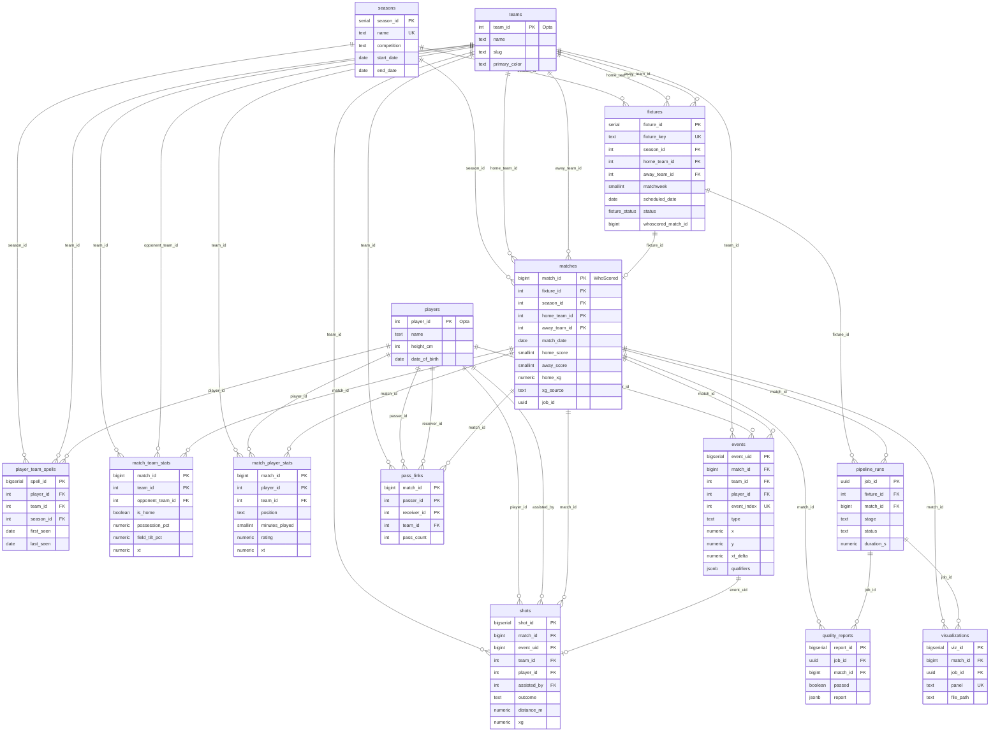
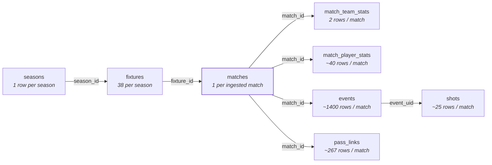

# Entity relationship diagram

Schema `gunners`, defined in [`db/schema.sql`](../db/schema.sql).
14 tables, 34 foreign keys, 4 views.

For grain, column detail, views and query recipes see
[docs/DATABASE.md](DATABASE.md) — this document covers the shape and the
referential integrity rules only.

---

## The shape

`matches` is the hub. Everything above it is calendar, everything below it is
per-match grain, and `teams` / `players` / `seasons` are the reference data that
both sides key off.

Attribute lists show keys and a few identifying columns, not every field —
`match_team_stats` and `match_player_stats` are 43 columns each.

---

## Ingest spine

The path a matchweek actually takes. Grain is what matters here: one fixture row
becomes one match row, which becomes five fact tables at five different grains.

`fixtures.status` walks the enum `scheduled → resolving → ready → ingesting →
ingested`, with `failed` and `postponed` as exits. `attempts` and `last_error`
sit on the same row, so a retry needs no state outside the table.

---

## Foreign keys and delete rules

Rows are the child holding the key, columns are the parent it points at.
Unmarked keys are `NO ACTION` — the parent row cannot be deleted while a child
references it.

| Child | → seasons | → teams | → players | → fixtures | → matches | → events | → pipeline_runs |
|---|---|---|---|---|---|---|---|
| `player_team_spells` | `season_id` ⌫ⁿ | `team_id` ⌫ᶜ | `player_id` ⌫ᶜ | | | | |
| `fixtures` | `season_id` ⌫ᶜ | `home_team_id` `away_team_id` | | | | | |
| `matches` | `season_id` ⌫ᶜ | `home_team_id` `away_team_id` | | `fixture_id` ⌫ⁿ | | | |
| `match_team_stats` | | `team_id` `opponent_team_id` | | | `match_id` ⌫ᶜ | | |
| `match_player_stats` | | `team_id` | `player_id` | | `match_id` ⌫ᶜ | | |
| `events` | | `team_id` | `player_id` | | `match_id` ⌫ᶜ | | |
| `shots` | | `team_id` | `player_id` `assisted_by` | | `match_id` ⌫ᶜ | `event_uid` ⌫ᶜ | |
| `pass_links` | | `team_id` | `passer_id` `receiver_id` | | `match_id` ⌫ᶜ | | |
| `pipeline_runs` | | | | `fixture_id` ⌫ⁿ | `match_id` ⌫ⁿ | | |
| `quality_reports` | | | | | `match_id` ⌫ᶜ | | `job_id` ⌫ᶜ |
| `visualizations` | | | | | `match_id` ⌫ᶜ | | `job_id` ⌫ⁿ |

⌫ᶜ `ON DELETE CASCADE` · ⌫ⁿ `ON DELETE SET NULL`

`seasons`, `teams` and `players` hold no foreign keys of their own, so they do
not appear as rows.

Two consequences worth knowing:

- **Deleting a match row wipes the match.** All five fact tables cascade, and so
  do `quality_reports` and `visualizations`. This is what makes a re-ingest a
  clean delete-and-reload.
- **Deleting a team or a player is blocked** while any match references it. The
  reference tables are effectively append-only once a match has been loaded.

---

## Keys and constraints

| Table | Primary key | Also unique |
|---|---|---|
| `seasons` | `season_id` (serial) | `name` |
| `teams` | `team_id` (Opta) | |
| `players` | `player_id` (Opta) | |
| `player_team_spells` | `spell_id` | `player_id, team_id, season_id` |
| `fixtures` | `fixture_id` | `fixture_key` |
| `matches` | `match_id` (WhoScored) | |
| `match_team_stats` | `match_id, team_id` | |
| `match_player_stats` | `match_id, player_id` | |
| `events` | `event_uid` | `match_id, event_index` |
| `shots` | `shot_id` | `match_id, event_uid` |
| `pass_links` | `match_id, passer_id, receiver_id` | |
| `pipeline_runs` | `job_id` (uuid) | |
| `quality_reports` | `report_id` | |
| `visualizations` | `viz_id` | `match_id, panel` |

Plus one check constraint worth naming: `chk_match_teams_differ` refuses a
`matches` row where home and away are the same club.

Nine secondary indexes, including a GIN index on `events.qualifiers` for jsonb
containment queries. Three `updated_at` triggers (`touch_updated_at()`) fire
before update on `fixtures`, `teams` and `players`.

---

## Why it is shaped this way

**Opta ids are the primary keys.** `teams`, `players` and `matches` use the
upstream id rather than a surrogate, so scraping the same match twice upserts
instead of duplicating. Re-ingest is idempotent by construction.

**A fixture is a plan, a match is a fact.** They are separate tables because a
scheduled fixture may never produce a match (postponed, abandoned), and a match
may arrive without a fixture — `matches.fixture_id` is nullable and `SET NULL`
on delete, so friendlies and cup ties load without a calendar row.

**Two tables denormalise the event stream.** `shots` and `pass_links` are both
derivable from `events` and stored anyway: the shot map and the pass network are
drawn for every match, and neither should scan ~1400 rows to do it.

**xG comes from outside the feed.** WhoScored does not publish it. Match-level
xG lands on `matches` tagged with `xg_source` (`fotmob` | `manual` | `model`);
per-shot `shots.xg` stays null until a model runs.

**Positions are metres, not percentages.** `events.x/y`, `shots.distance_m`,
`match_team_stats.def_action_height_m` and friends are all normalised to a
105×68 pitch at transform time, so the warehouse and the visualiser share one
coordinate space.

**Pipeline bookkeeping sits beside the data, not inside it.** `pipeline_runs`
books a job against the fixture that triggered it and the match it produced —
both nullable, so a run that fails before resolving a match id still gets a row.
`quality_reports` and `visualizations` carry `job_id` *and* `match_id`, which is
what lets a re-run's artefacts be told apart from the previous run's.
